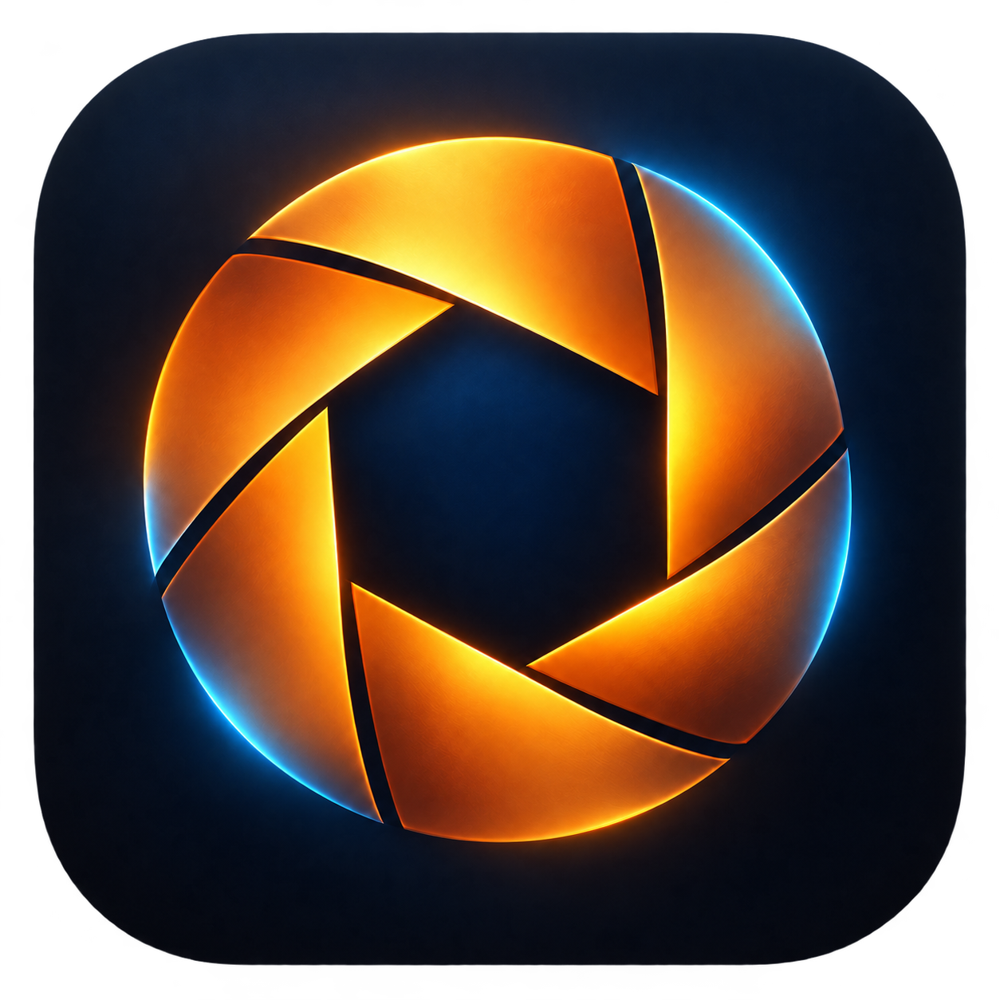
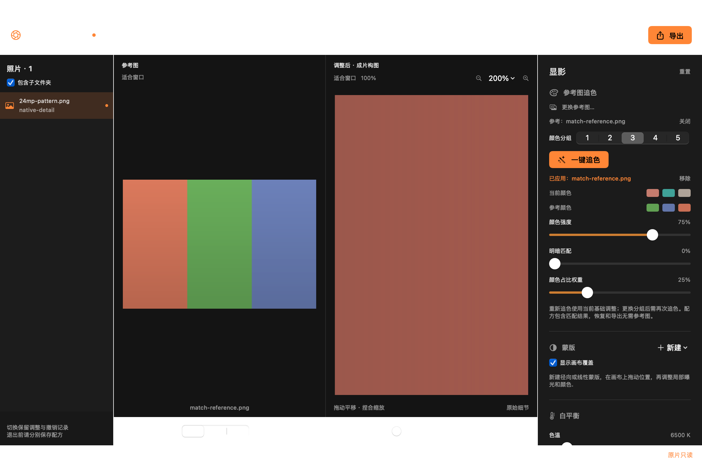

<p align="center">
  
</p>

<h1 align="center">Luma RAW</h1>

<p align="center">在 Mac 上显影 RAW、参考照片追色，再放大检查每一处细节。</p>

<p align="center">
  <a href="https://github.com/pw0rld/luma-raw-editor/actions/workflows/macos.yml"></a>
  
  
</p>

<p align="center">
  <a href="https://github.com/pw0rld/luma-raw-editor/releases">下载发布版</a> ·
  <a href="#下载与运行">试用当前开发版</a> ·
  <a href="DEVELOPMENT_STATUS.md">开发进度</a> ·
  <a href="ROADMAP.md">路线图</a> ·
  <a href="COMPETITOR_RESEARCH.md">同行调研</a>
</p>

Luma RAW 是使用 SwiftUI、Core Image 和 Metal 开发的 macOS 原生照片编辑器。显影、参考图追色和局部调整都在本机完成，无需账号或外部 AI 服务。原片保持只读，调整可保存为独立配方。

**当前状态（2026-10-27）：** 本文介绍 `main` 分支，应用版本仍为 `0.4.0 / build 4`，已加入 0.5 阶段的画布导航和原始分辨率细节查看。直方图与溢出提示待完成，0.5 尚未发布；目前 GitHub 上可下载的正式 Release 为 **v0.3.0**。



*当前开发版的真实窗口截图，使用合成色块和单像素纹理测试素材；右侧已完成 200% 原始细节加载。*

## 已有功能

| 功能 | 当前能力 |
| --- | --- |
| 图片与文件夹导入 | RAW 和普通图片；可包含子文件夹；自然排序、路径去重，按需解码 |
| 基础显影 | 白平衡、曝光、饱和度、三点色调曲线，支持原片比较 |
| 参考图追色 | 参考图并排查看、1–5 个颜色分组；颜色强度、明暗匹配与颜色占比权重独立可调 |
| 局部蒙版 | 径向与有范围的线性渐变；局部曝光、白平衡、饱和度，支持羽化、反向与停用 |
| 裁剪与旋转 | 自由比例裁剪框，可移动和拖动四角；90° 旋转，选区随图像同步变换 |
| 细节查看 | 适合窗口、100% / 200%、连续缩放与平移；原始分辨率视口分块加载，显示加载进度 |
| 编辑与恢复 | 每张照片独立保留调整和撤销/重做；自动保存本地草稿，重启恢复会话 |
| 独立配方 | `.luma.json` 保存、恢复和原片校验，内嵌追色与蒙版参数 |
| 导出 | JPEG 8 bit / TIFF 16 bit，嵌入 sRGB；保留可用拍摄信息，GPS 可选 |

完整完成项和待办见 [开发进度](DEVELOPMENT_STATUS.md)。

## 下载与运行

需要 **macOS 13 或更高版本**。预编译产物面向 **Apple Silicon / arm64**；Intel Mac 可尝试从源码构建，尚未做 Intel 真机验收。

| 获取方式 | 适合用途 | 说明 |
| --- | --- | --- |
| [Release v0.3.0](https://github.com/pw0rld/luma-raw-editor/releases/tag/v0.3.0) | 试用早期发布版 | 包含文件夹导入、追色和裁剪；不包含后续的蒙版、自动草稿及原生细节查看 |
| [GitHub Actions](https://github.com/pw0rld/luma-raw-editor/actions/workflows/macos.yml) | 试用当前开发版 | 选择 `main` 最近一次成功运行，在 Artifacts 下载 `LumaRAW-macos`；产物有保留期限 |
| [从源码构建](#从源码构建) | 开发或获取最新功能 | 构建当前分支，生成完整 `.app` |

下载压缩包后解压并打开 **Luma RAW.app**。Actions 下载包中还有一层应用 ZIP，需要再解压一次。源码仓库不包含已编译的 `.app`。

当前应用使用 ad-hoc 签名，尚未公证；首次运行如被系统拦截，可在系统设置「隐私与安全性」中确认打开。

## 开始编辑

1. **导入照片**：点击「添加文件夹」载入一组照片，默认包含子文件夹；也可用「导入」添加单张。左侧点击切图，各张照片分别保留调整和历史。
2. **建立整体色调**：调整白平衡、曝光、饱和度与曲线。想参考另一张照片时，点击「参考图」，再在右侧点击「一键追色」。默认颜色强度为 75%、明暗匹配为 0%，可继续微调。
3. **调整构图与局部**：底栏切到「裁剪」后移动或缩放裁剪框；需要局部调整时，在右侧新建径向或线性蒙版，切到「蒙版」工具编辑范围。切回「浏览」查看最终成片构图。
4. **检查细节**：点击画布上方「100%」，等待底栏显示「原始细节」后检查纹理；可继续放大到 200%，拖动查看其他位置。
5. **保存与导出**：「保存配方」生成独立 `.luma.json`；「导出」生成 JPEG 或 TIFF。自动草稿负责本机恢复，独立配方用于备份和迁移。

### 画布操作

| 操作 | 方式 |
| --- | --- |
| 回到完整构图 | 点击「适合窗口」 |
| 指定倍率 | 点击「100%」，或在倍率菜单选择 50% / 100% / 200% |
| 连续缩放 | 触控板捏合、⌘＋滚轮，或放大/缩小按钮；支持 1%–800% |
| 平移 | 浏览模式直接拖动，或使用滚轮/触控板滚动 |
| 编辑选区时平移 | 按住空格拖动，裁剪框和蒙版继续保持原位置 |
| 快速切换适合窗口 / 100% | 浏览模式双击，或使用触控板智能缩放手势 |

**100% 指一个处理后的照片像素对应一个屏幕物理像素**，已处理 Retina 显示比例。画布先显示底图，再补全当前视口的原始细节；缩放和平移不修改配方，也不进入调色撤销历史。切换照片、工具、旋转或原片比较时恢复适合窗口。

### 常用快捷键

| 操作 | 快捷键 |
| --- | --- |
| 导入 / 添加文件夹 | ⌘O / ⌥⌘O |
| 导入参考图 / 一键追色 | ⌥⌘R / ⇧⌘M |
| 保存 / 恢复配方 | ⌘S / ⇧⌘O |
| 导出 | ⇧⌘E |
| 撤销 / 重做 | ⌘Z / ⇧⌘Z |
| 切换原片比较 | 反斜杠 `\` |

滑块拖动合并为一次撤销，最多保留 100 步。原片比较显示未裁剪、未旋转的初始显影。

## 追色与蒙版

追色采用 Lab 颜色分簇和亮度分布映射，思路参考 [darktable Color mapping 的公开说明](https://docs.darktable.org/usermanual/development/en/module-reference/processing-modules/color-mapping/)，由 Swift 和 Core Image 独立实现；没有复制或链接 darktable / G’MIC 源码。

- **颜色强度**控制整体颜色转移；**明暗匹配**单独控制亮度分布，二者可分别关闭。
- **颜色分组**支持 1–5，默认 3；更改后需重新点击「一键追色」。**颜色占比权重**控制画面中颜色所占面积对分组对应关系的影响。
- 更换参考图只改变参考预览；重新点击追色才替换已应用结果。重新分析会排除旧匹配，不会累计叠加。
- 已生成的追色参数保持固定，之后修改曝光或白平衡不会自动重新分析；需要时可再次追色。

当前追色根据整体颜色分布工作，尚无肤色保护或物体识别。构图和光线差异较大时，可降低强度、减少分组，或选择更接近的参考图。局部蒙版目前调整曝光、白平衡和饱和度，处理顺序在全局追色之前；追色的独立分析选区和作用蒙版计划在后续实现。

## 保存、恢复与文件保护

停止编辑约 700 ms 后，草稿写入：

```text
~/Library/Application Support/Luma RAW/Drafts/workspace.json
```

正常退出会等待写入；崩溃后恢复最近完成写入的草稿。草稿包含照片列表、选择、调整和历史，依赖原片仍然可访问。导出照片后，仍可单独保存配方。

恢复独立配方时，先导入同一原片，再使用「恢复配方」。程序通过 SHA-256 校验原片，文件可移动或改名。追色结果和蒙版已嵌入配方，恢复与导出无需重新找到参考图。

配方当前为 schema v3，支持读取并迁移 v1/v2。RAW 解码器版本或默认配置变化时会明确拒绝不兼容的恢复，尚无跨系统解码版本迁移。旧线性蒙版保留原渐变跨度，可手动转换；旧配方建议保留备份，具体兼容说明见 [开发进度](DEVELOPMENT_STATUS.md#兼容与恢复)。

原片只读，保存配方和导出采用原子写入，并检查原片、参考原片、符号链接目标及文件标识，防止覆盖。导出保留可用的 EXIF / IPTC 等信息，GPS 默认去除；不保证保留厂商私有元数据、完整 XMP 或辅助图像。

## 从源码构建

需要 macOS SDK、Swift 6 工具链，以及构建脚本使用的 Python 3。无第三方运行依赖。推荐安装匹配版本的 Xcode 或 Command Line Tools。

```bash
git clone git@github.com:pw0rld/luma-raw-editor.git
cd luma-raw-editor
bash scripts/build.sh
open "Luma RAW.app"
```

脚本通过 `xcrun swiftc` 编译核心库与 SwiftUI 应用、生成图标、打包并签名。默认构建本机架构，最低部署版本为 macOS 13。`LUMA_BUILD_DIR` 可指定中间产物目录。

也提供 [Package.swift](Package.swift)，可在匹配的完整 Xcode 环境中使用 `swift build` / `swift test`；生成可分发应用包请使用上述脚本。

### 运行检查

完整构建检查，包含像素渲染、合成 DNG、草稿恢复、原生画布输入、文件夹和追色集成：

```bash
LUMA_RAW_FIXTURE="$PWD/Samples/synthetic-bayer.dng" bash scripts/build.sh --check
```

仅检查不依赖图像渲染的模型逻辑：

```bash
bash scripts/build.sh --check-model
```

`--check-model` 明确排除像素渲染，不能替代完整检查。完整检查需要可访问 Core Image / Metal 与系统窗口服务的 macOS 环境。

`.github/workflows/macos.yml` 在主分支推送和 PR 时构建、运行完整检查，并保存应用和验证日志。发布工作流在推送 `v*` 标签时检查版本、arm64 架构与签名，再创建 Release。

<details>
<summary>本机 Command Line Tools 兼容处理</summary>

开发机器曾遇到旧 `PackageDescription.private.swiftinterface` 与动态库版本不一致，以及 SwiftBridging 重复 modulemap。直接编译脚本配合项目内 VFS overlay 可绕过本机重复模块，未修改系统工具链：

```bash
python3 scripts/local-toolchain-overlay.py .build-direct
LUMA_TOOLCHAIN_OVERLAY="$PWD/.build-direct/toolchain-overlay.json" \
LUMA_RAW_FIXTURE="$PWD/Samples/synthetic-bayer.dng" \
bash scripts/build.sh --check
```

正常工具链不需要 overlay。其他 SDK / 编译器问题应修复或选择匹配的 Xcode / CLT；该脚本不是通用工具链修复方案。

</details>

## 图像管线

`ImageEngine` 使用串行 actor 在后台管理 RAW 解码和 Core Image 渲染，优先使用 Metal。工作空间为 **extended linear Display P3**，工作格式为 **RGBAh / 16 位半浮点**。

RAW 使用系统 `CIRAWFilter`、相机白平衡及默认 SDR 成像；普通图片读取嵌入 ICC 并按 EXIF 方向转正。共同后处理顺序为：

```text
基础显影 → 色调曲线 → 饱和度 → 90° 旋转 → 局部蒙版 → 裁剪 → 参考图追色 → sRGB 输出
```

交互底图长边最多 1800 像素；原始细节使用独立全分辨率 RAW 解码器和同一调整管线，先完整处理再切出视口。1024×1024 分块带 2 像素重叠，100% 及以上使用原始像素；分块 LRU 上限 48 MiB。RAW 解码缓冲和 Core Image / Metal 缓存另外占用内存。

视口为 SDR sRGB / 8 bit 显示，JPEG 导出为 8 bit，TIFF 为 16 bit 整数；浮点工作缓冲不代表 HDR 输出。已开始的 GPU 渲染不能中途抢占，程序会取消尚未开始的旧请求并拒绝过期结果。

源码入口：

| 路径 | 职责 |
| --- | --- |
| `Sources/LumaCore/ImageEngine.swift` | 解码、处理、细节缓存、元数据与导出 |
| `Sources/LumaCore/ColorMatch.swift` | 追色统计、簇对应与明暗映射 |
| `Sources/LumaCore/ViewportTransform.swift`、`DetailPreview.swift` | 画布坐标、物理像素倍率和分块计划 |
| `Sources/LumaCore/Recipe.swift`、`DraftStore.swift` | 配方、编辑历史和原子草稿 |
| `Sources/LumaCore/MaskGeometry.swift`、`PhotoFolder.swift` | 蒙版几何和文件夹扫描 |
| `Sources/LumaRAW` | SwiftUI 界面、编辑模型和原生画布输入 |
| `Tests/LumaCoreTests`、`scripts` | 核心测试、集成检查与构建工具 |

## 验证与后续计划

截至 2026-10-27，原生细节功能提交 `d494e11` 的 [GitHub 完整检查已通过](https://github.com/pw0rld/luma-raw-editor/actions/runs/40463800100)：**276 项核心断言**，以及草稿、细节状态、原生输入、文件夹和追色集成检查。本机也完成 RGB / 合成 DNG 的真实窗口验证，包含 Retina 下 100% / 200% 查看，以及细节与 TIFF 对应区域的像素核对。详细记录见 [VALIDATION.txt](VALIDATION.txt)。

当前主要边界：

- RAW 兼容性取决于 macOS 系统解码支持；尚未完成多相机真实 RAW、ProRAW、实际噪声/高光与跨相机追色质量评估。
- 已测 24MP 合成 RGB 的查看性能，真实大像素相机 RAW 的延迟、峰值内存与交互性能仍待测量。
- 蒙版目前提供径向和线性渐变；画笔、颜色/亮度范围、主体/天空识别待实现。
- 当前逐张编辑与导出；批量套用、批量追色/导出和完整图库待实现。
- 直方图、成片溢出提示、固定裁剪比例、拉直、透视、HDR、自动更新与公证待完成。
- macOS 13、Intel 和不同物理显示器的全面验收尚未完成；Windows / Linux 需要替代现有 Apple 平台的 UI、RAW 和渲染后端。

路线按 **0.5 查看与细节检查 → 0.6 批处理 → 0.7 可控追色** 推进。下一项为 **直方图与成片溢出提示**，具体验收条件见 [路线图](ROADMAP.md)。
